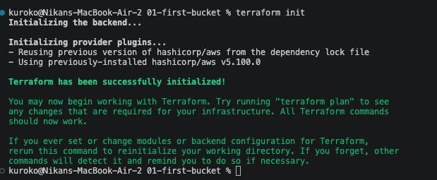
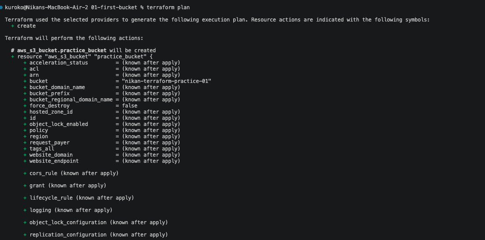
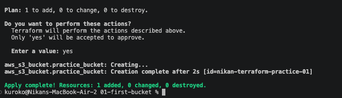

# 01 — First resource: one S3 bucket

Goal of this exercise: go from an empty folder to one real S3 bucket on AWS, created entirely from code, no console clicking. Just enough to see the full Terraform workflow once, end to end, with the smallest possible resource. Code lives in [`01-first-bucket/main.tf`](../01-first-bucket/main.tf).

## The file

```hcl
terraform {
  required_providers {
    aws = {
      source  = "hashicorp/aws"
      version = "~> 5.0" # any 5.x version, not 6.0
    }
  }
}

provider "aws" {
  region = "us-east-1"
}

resource "aws_s3_bucket" "practice_bucket" {
  bucket = "nikan-terraform-practice-01"
}
```

`practice_bucket` is a local name, only used inside this project to refer to the resource — never seen by AWS. `bucket = "..."` is the real bucket name, which has to be globally unique across all of AWS, not just my account.

**A real mistake, caught immediately:** first wrote `provider = "aws"{` — `provider` is a labeled block, same shape as `resource`, not a key assigned with `=`. Correct form: `provider "aws" { ... }`, no `=` between the keyword and the label.

## Running it

**`terraform init`** — downloads the AWS provider (v5.100.0) and creates the lock file:



**`terraform plan`** — `Plan: 1 to add, 0 to change, 0 to destroy`. Confirms the code is valid and the AWS credentials actually work, before touching anything real:



**`terraform apply`** — same plan shown again, then a real confirmation prompt (`Enter a value:`, only `yes` accepted). Typed `yes`, bucket created in 2 seconds:



Resulting `id`: `nikan-terraform-practice-01` (for an S3 bucket, the `id` is just the bucket name — visible in the apply output as `[id=nikan-terraform-practice-01]`).

## Using a dedicated IAM user, not my main credentials

Created a separate IAM user (`terraform-practice`) with only `AmazonS3FullAccess` attached, instead of reusing the least-privilege user already scoped to Nik-Blog's bucket. Keeps this practice account's blast radius limited to what these exercises actually touch, and keeps Nik-Blog's production IAM user untouched by anything I'm still learning.
