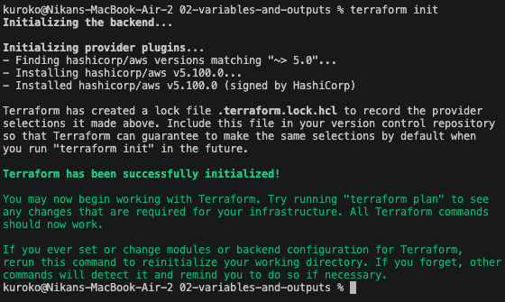
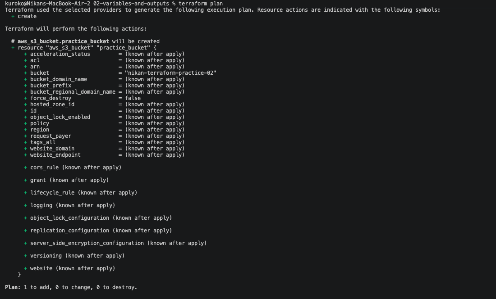
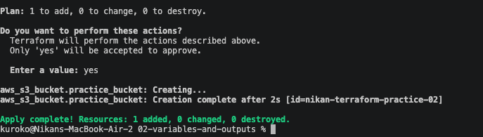
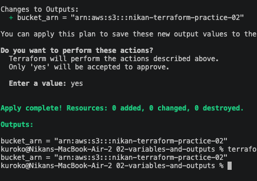

# 02 — Variables and outputs

Same S3 bucket as exercise 01, but this time the bucket name isn't hardcoded, and after creating it I can read its ARN back without running `terraform show` by hand. Code in [`02-variables-and-outputs/`](../02-variables-and-outputs/).

## `variables.tf` — an input

```hcl
variable "bucket_name" {
    description = "Name of the S3 bucket to create"
    type = string
    default = "nikan-terraform-practice-02"
}
```

`variable` is its own block, same shape as `resource` or `provider` — not a plain assignment. `type = string` makes Terraform reject a non-string value instead of silently accepting one. `default` means I don't have to pass a value every time; if I didn't set one, Terraform would just prompt for it at the start of `plan`/`apply`.

## `main.tf` — reading the variable

```hcl
resource "aws_s3_bucket" "practice_bucket" {
  bucket = var.bucket_name
}
```

`var.bucket_name` reads the value instead of me typing the real bucket name directly in the resource. Everything else (the `terraform {}` and `provider {}` blocks) is unchanged from exercise 01.

## `outputs.tf` — reading a value back out

```hcl
output "bucket_arn"{
    description = "Real ARN after bucket creation"
    value       = aws_s3_bucket.practice_bucket.arn
}
```

`value` follows the same pattern as any attribute reference I've used in `terraform show`: `<resource_type>.<local_name>.<attribute>`.

## The sequence that actually happened, not the clean version

Ran `init` → `plan` → `apply` first with just `main.tf` and `variables.tf` — the bucket got created (`nikan-terraform-practice-02`):





Then wrote `outputs.tf` *after* the bucket already existed. Running `terraform output` alone printed nothing useful yet — an output only gets computed into state once Terraform actually evaluates it, which needs another `plan`/`apply`. Ran `terraform apply` again:

```
Changes to Outputs:
  + bucket_arn = "arn:aws:s3:::nikan-terraform-practice-02"

Apply complete! Resources: 0 added, 0 changed, 0 destroyed.

Outputs:

bucket_arn = "arn:aws:s3:::nikan-terraform-practice-02"
```

`0 added, 0 changed, 0 destroyed` — nothing about the real bucket changed, Terraform only recorded the new output value. This was a genuinely useful accident: it shows outputs aren't static documentation, they're computed and stored the same way resources are, and adding one after the fact still needs an `apply` to take effect:



After that, `terraform output bucket_arn` or a plain `terraform output` prints it instantly from state, no re-apply needed, until something actually changes.
