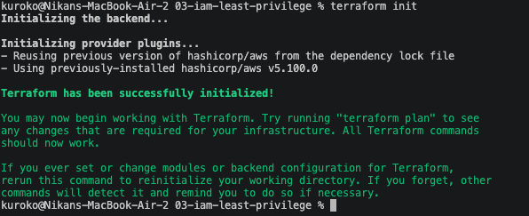
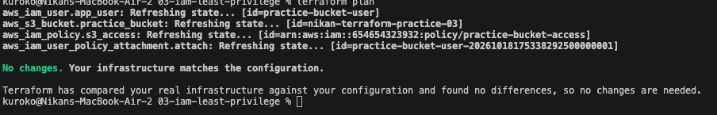
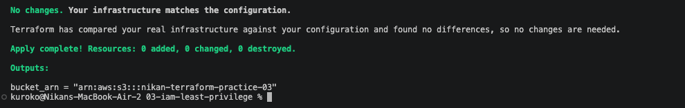

# 03 — IAM user + policy, scoped to one bucket

This is the exercise that matters most for my résumé story: not just "I can create an S3 bucket," but "I can write the same least-privilege IAM pattern I already built by hand for Nik-Blog, this time as code." Code in [`03-iam-least-privilege/`](../03-iam-least-privilege/).

## What gets created

1. An S3 bucket (same pattern as exercises 01/02, name from a `variable`).
2. An IAM **user** — just an identity, no permissions yet on its own.
3. An IAM **policy** — a standalone permission document, not attached to anything yet.
4. An **attachment** — the thing that actually connects the policy to the user.

These are four separate resources on purpose. A policy with nothing attached to it has zero effect; a user with no policy attached has zero permissions. Terraform doesn't implicitly connect them — the attachment resource is what does that.

## The policy itself

```hcl
resource "aws_iam_policy" "s3_access" {
  name = "practice-bucket-access"

  policy = jsonencode({
    Version = "2012-10-17"
    Statement = [
      {
        Effect   = "Allow"
        Action   = ["s3:PutObject", "s3:GetObject", "s3:DeleteObject"]
        Resource = "${aws_s3_bucket.practice_bucket.arn}/*"
      }
    ]
  })
}
```

`jsonencode(...)` turns an ordinary HCL object into a real JSON string, because AWS IAM policies are always JSON, regardless of what tool writes them. `Version = "2012-10-17"` is a fixed constant — it's the IAM policy language version, not a real date tied to this project. `Resource = "${aws_s3_bucket.practice_bucket.arn}/*"` uses string interpolation (`${...}`) to pull in the real ARN of the bucket defined earlier in the same file — the `/*` matters: without it, the permission would apply to the bucket itself, not the objects inside it, which is a real and common AWS IAM distinction.

```hcl
resource "aws_iam_user_policy_attachment" "attach" {
  user       = aws_iam_user.app_user.name
  policy_arn = aws_iam_policy.s3_access.arn
}
```

No `${}` needed here — these values are full references used directly as the whole argument, not interpolated into a larger string. `${}` is only for sitting a value inside other text.

## A real permissions wall, not a toy error

First `apply` partially failed:

```
aws_s3_bucket.practice_bucket: Creation complete after 2s [id=nikan-terraform-practice-03]
Error: creating IAM User (practice-bucket-user): ... AccessDenied: User: .../terraform-practice
is not authorized to perform: iam:CreateUser ...
Error: creating IAM Policy (practice-bucket-access): ... AccessDenied: ... iam:CreatePolicy ...
```

The bucket got created (the `terraform-practice` IAM user I'd set up only had `AmazonS3FullAccess`), but the user and policy didn't — that same IAM user had zero IAM permissions of its own. A real, honest permissions wall, not a code bug.

Fixed it the same way this whole exercise is about: not with a blanket `IAMFullAccess`, but an inline policy scoped to exactly what this exercise needs, on resources matching the `practice-bucket-*` naming convention only:

```json
{
  "Version": "2012-10-17",
  "Statement": [
    {
      "Effect": "Allow",
      "Action": [
        "iam:CreateUser", "iam:DeleteUser", "iam:GetUser", "iam:TagUser",
        "iam:CreatePolicy", "iam:DeletePolicy", "iam:GetPolicy",
        "iam:GetPolicyVersion", "iam:ListPolicyVersions",
        "iam:AttachUserPolicy", "iam:DetachUserPolicy", "iam:ListAttachedUserPolicies"
      ],
      "Resource": [
        "arn:aws:iam::654654323932:user/practice-bucket-*",
        "arn:aws:iam::654654323932:policy/practice-bucket-*"
      ]
    }
  ]
}
```

Re-ran `apply`. This time: `Plan: 3 to add` — not 4. Terraform had already recorded the bucket as created in state from the failed run, so it only created the three resources that were actually still missing, instead of starting over from scratch:

```
aws_iam_user.app_user: Creation complete [id=practice-bucket-user]
aws_iam_policy.s3_access: Creation complete [id=arn:aws:iam::654654323932:policy/practice-bucket-access]
aws_iam_user_policy_attachment.attach: Creation complete

Apply complete! Resources: 3 added, 0 changed, 0 destroyed.
bucket_arn = "arn:aws:s3:::nikan-terraform-practice-03"
```

## Verified with a clean re-run

Ran `init` → `plan` → `apply` again from scratch to confirm the real infrastructure now fully matches the code, with nothing left over from the earlier partial failure:





`No changes. Your infrastructure matches the configuration.` — exactly what should happen when nothing's actually different. This is also what makes Terraform safe to re-run: applying the same config twice doesn't recreate or duplicate anything, it just confirms reality matches the code.
