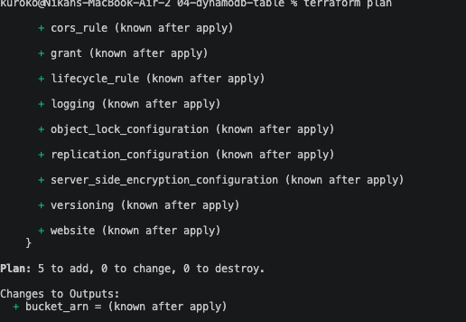
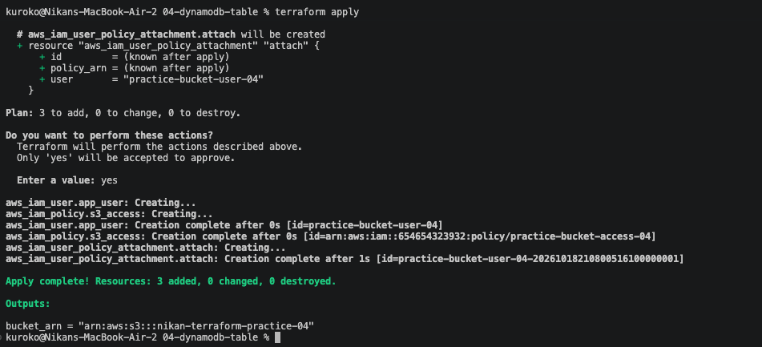

# 04 — A second resource type: DynamoDB table

Point of this exercise: make sure the building blocks from exercises 01–03 aren't S3-specific knowledge — apply the exact same `resource` pattern to a completely different AWS service. Reused the full bucket + IAM user/policy/attachment setup from exercise 03 and added one new resource type. Code in [`04-dynamodb-table/`](../04-dynamodb-table/).

## The new resource

```hcl
resource "aws_dynamodb_table" "practice_table" {
  name         = "practice-items"
  billing_mode = "PAY_PER_REQUEST"
  hash_key     = "id"

  attribute {
    name = "id"
    type = "S"
  }
}
```

- **`billing_mode = "PAY_PER_REQUEST"`** — pay only for the requests actually made, no capacity to provision or guess ahead of time. The right default for a practice table or small project; `PROVISIONED` mode needs an explicit read/write capacity guess, which either throttles (too low) or wastes money (too high).
- **`hash_key = "id"`** — the partition key. Every item in the table needs a unique value for this column.
- **`attribute { name = "id", type = "S" }`** — a real DynamoDB-specific thing, different from a SQL table: only the attributes used as keys need to be declared up front. DynamoDB is schema-less beyond its keys — any item can carry whatever other fields it wants, undeclared. `type = "S"` is string; `"N"` is number, `"B"` is binary.

## A permissions wall, again — this time a naming one, not an access one

First `apply` partially failed, but differently from exercise 03's `AccessDenied`:

```
EntityAlreadyExists: User with name practice-bucket-user already exists.
EntityAlreadyExists: A policy called practice-bucket-access already exists.
```

The bucket and the DynamoDB table were created fine. The IAM user and policy failed — not from missing permissions this time, but because I'd copied exercise 03's `main.tf` as a starting point and left the IAM user/policy names (`practice-bucket-user`, `practice-bucket-access`) exactly as they were. **IAM names are unique per AWS account, not per Terraform project.** Exercise 03 and exercise 04 are two completely separate Terraform projects with their own state files, but they both point at the same real AWS account — so from AWS's point of view, two unrelated projects tried to create a resource with an identical name, which it refuses regardless of which `.tf` file asked for it.

This is the IAM version of the same constraint S3 bucket names already taught in exercise 01 (global uniqueness) — just scoped to the account instead of to all of AWS.

Fixed by giving this exercise's IAM resources their own unique names:

```hcl
resource "aws_iam_user" "app_user" {
  name = "practice-bucket-user-04"
}

resource "aws_iam_policy" "s3_access" {
  name = "practice-bucket-access-04"
  ...
```

No change needed to the `terraform-practice-iam` permissions policy itself — it was already scoped to the `practice-bucket-*` wildcard pattern, which covers the `-04` suffix automatically.

## Re-running apply

Re-ran `plan` — `5 to add` the first time (bucket, user, policy, table, attachment):



After the name fix, re-ran `apply` — this time `3 to add`, not 5, since Terraform's state already had the bucket and the DynamoDB table recorded as created from the earlier partial run:

```
aws_iam_user.app_user: Creation complete [id=practice-bucket-user-04]
aws_iam_policy.s3_access: Creation complete [id=arn:aws:iam::654654323932:policy/practice-bucket-access-04]
aws_iam_user_policy_attachment.attach: Creation complete

Apply complete! Resources: 3 added, 0 changed, 0 destroyed.
bucket_arn = "arn:aws:s3:::nikan-terraform-practice-04"
```



Same lesson as exercise 03's partial failure, from a different cause this time: Terraform tracks exactly what succeeded and what didn't, and a re-run only touches what's actually still missing.
