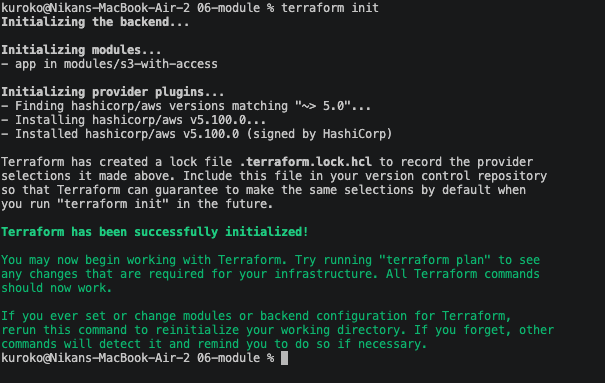
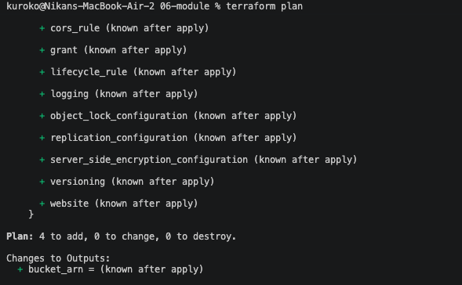
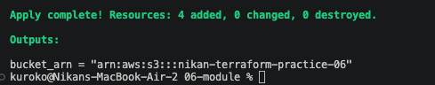

# 06 — Combining everything into one reusable module

Last core exercise. Exercises 03 and 04 both hand-wrote the same bucket + IAM user + policy + attachment pattern, copy-pasted with different names. A module is how Terraform avoids that: write the pattern once, call it with different parameters instead of duplicating the code. Code in [`06-module/`](../06-module/).

## Two different roles, two different folders

```
06-module/
├── main.tf                        — root: calls the module
├── outputs.tf                     — root: re-exposes the module's output
└── modules/
    └── s3-with-access/
        ├── main.tf                — the pattern itself
        ├── variables.tf           — its inputs
        └── outputs.tf             — its own output
```

A module doesn't declare `terraform {}` or `provider {}` — it doesn't know, and shouldn't need to know, which AWS account or region it'll run in. It's a template, not a standalone project.

## The module itself ([`modules/s3-with-access/`](../06-module/modules/s3-with-access/))

```hcl
# variables.tf
variable "bucket_name" {
  type = string
}

variable "user_name" {
  type = string
}
```

```hcl
# main.tf — same four resources as exercise 03, parameterized
resource "aws_s3_bucket" "practice_bucket" {
  bucket = var.bucket_name
}

resource "aws_iam_user" "app_user" {
  name = var.user_name
}

resource "aws_iam_policy" "s3_access" {
  name = "${var.user_name}-access"
  policy = jsonencode({
    Version = "2012-10-17"
    Statement = [
      {
        Effect   = "Allow"
        Action   = ["s3:PutObject", "s3:GetObject", "s3:DeleteObject"]
        Resource = "${aws_s3_bucket.practice_bucket.arn}/*"
      }
    ]
  })
}

resource "aws_iam_user_policy_attachment" "attach" {
  user       = aws_iam_user.app_user.name
  policy_arn = aws_iam_policy.s3_access.arn
}
```

```hcl
# outputs.tf — what this module exposes to whoever calls it
output "bucket_arn" {
  value = aws_s3_bucket.practice_bucket.arn
}
```

## Calling it from root ([`06-module/main.tf`](../06-module/main.tf))

```hcl
terraform {
  required_providers {
    aws = {
      source  = "hashicorp/aws"
      version = "~> 5.0"
    }
  }
}

provider "aws" {
  region = "us-east-1"
}

module "app" {
  source = "./modules/s3-with-access"

  bucket_name = "nikan-terraform-practice-06"
  user_name   = "practice-bucket-user-06"
}
```

`module "app"` is a labeled block, same shape as `resource` or `provider`. `source` points at the module's folder. `bucket_name`/`user_name` fill in the module's own `variable` blocks — from the module's side, no different from being called by any root project.

## A real mix-up: two outputs that look almost identical but aren't

First attempt put this in the **module's own** `outputs.tf`:
```hcl
output "bucket_arn" {
  value = module.app.bucket_arn
}
```
Failed immediately:
```
Error: Reference to undeclared module
No module call named "app" is declared in module.app.
```
`module.app` only means something from the **root's** point of view — that's where `module "app" { ... }` is actually declared. Inside the module itself, there's no "module.app" to reference; the module can only output its own resources directly (`aws_s3_bucket.practice_bucket.arn`).

The fix needed two separate `output "bucket_arn"` blocks in two different places, which look confusingly similar but mean different things:
- **inside the module** (`modules/s3-with-access/outputs.tf`): exposes the module's own resource value outward.
- **at root** (`06-module/outputs.tf`, a new file): reads that value back in via `module.app.bucket_arn` and re-exposes it as the whole project's output.

## Verified end to end

```
terraform init
- app in modules/s3-with-access
```
Terraform recognizes and initializes the module as its own unit:



`terraform plan`: `4 to add` (bucket, user, policy, attachment — same four resources as exercise 03, just sourced from the module instead of written inline):



`terraform apply`:
```
Apply complete! Resources: 4 added, 0 changed, 0 destroyed.
bucket_arn = "arn:aws:s3:::nikan-terraform-practice-06"
```



Same four resources exercises 03 and 04 each hand-wrote separately — this time from one reusable definition, callable again with different parameters without copying a single line.

## This closes the core exercise set

Six exercises, six real things verified end to end on AWS, not just read about: a single resource and the `init`/`plan`/`apply` cycle, variables and outputs, least-privilege IAM, a second resource type, remote state with locking, and a reusable module. Real errors hit and fixed along the way, not a clean-only narrative: a labeled-block-vs-assignment syntax mistake, a real `AccessDenied` wall (and later an `iam:ListGroupsForUser` one on `destroy`), an `EntityAlreadyExists` collision from IAM's account-wide naming, and this module-scope mix-up. Next real step: `terraform import` on Nik-Blog's actual hand-created S3 bucket and IAM user.
